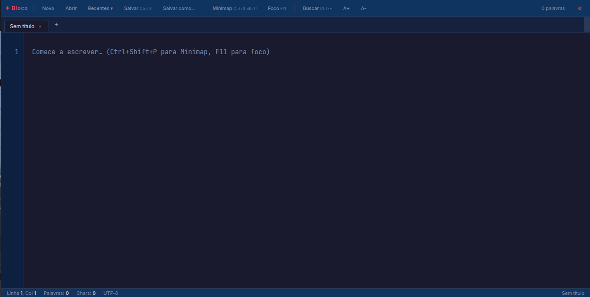
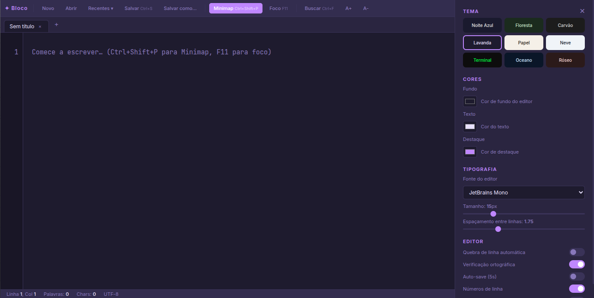
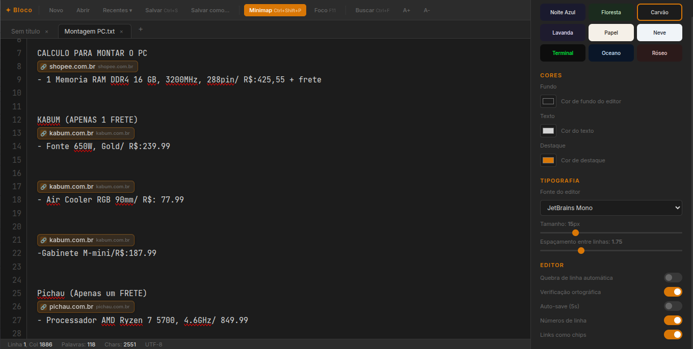

<div align="center">

# ✦ Bloco Custom

**A feature-rich, fully customizable text editor built entirely with vanilla HTML, CSS, and JavaScript — no frameworks, no dependencies.**

[](https://developer.mozilla.org/en-US/docs/Web/HTML)
[](https://developer.mozilla.org/en-US/docs/Web/CSS)
[](https://developer.mozilla.org/en-US/docs/Web/JavaScript)
[](LICENSE)
[](#)

> 🇧🇷 [Leia em Português](README.pt-BR.md)

</div>

---

## Overview

**Bloco Custom** started as a personal replacement for Windows Notepad — a tool I built from scratch because the default experience was too plain and inflexible. What began as a simple HTML file evolved into a full-featured desktop-grade text editor, packagable as a standalone executable.

The entire application is **four files** with zero external runtime dependencies, demonstrating what's achievable with pure web standards.

---

## Project Structure

```
bloco-custom/
├── index.html   — Markup: all UI structure and layout
├── style.css    — Styles: themes, components, CSS custom properties
├── utils.js     — Pure helpers (search, URLs, word count…) shared with the tests
├── main.js      — Logic: editor engine, tabs, minimap, file ops, link chips, session
├── manifest.webmanifest — Makes the app installable and registers it for .txt, .md…
├── sw.js        — Service worker: the installed app works offline
├── icons/       — App icons
├── tests/       — Zero-dependency browser test suite (unit + integration)
├── README.md
└── README.pt-BR.md
```

---

## Features

### Editor Core
- **`contenteditable` div** as the editing surface — allows real inline HTML nodes (used for link chips)
- **Line numbers** synced with scroll, with current-line highlight — VS Code style
- **Tab key** inserts 4 spaces, `Shift+Tab` removes them; `Enter` keeps the current indentation
- **Paste is always plain text** — formatting from web pages or Word never leaks into the note
- **Word wrap** toggle (`Alt+Z`)
- **Spellcheck** toggle
- **Live word, character, line, column, and selection count** in the status bar, plus the file's line ending (LF/CRLF)

### Tab System
- **Multiple tabs** — open as many files as needed simultaneously
- **Drag-and-drop reordering** between tabs; **double-click to rename**, middle-click to close
- **Unsaved changes indicator** (●) per tab and in the window title
- **Session restore** — open tabs (and their unsaved text) come back when you reopen the app
- Keyboard shortcuts: `Ctrl+T` new tab, `Ctrl+W` close, `Ctrl+Tab` cycle

### Minimap
- **VS Code-style minimap** rendered on an HTML5 `<canvas>` at the right edge
- Clickable and draggable — click anywhere to jump to that position in the document
- Viewport indicator shows the currently visible region
- Current line highlighted in the minimap
- Comment lines and headings rendered in distinct colors
- Toggle with `Ctrl+Shift+P`

### Link Chips
- Optional **inline link preview** — when enabled, raw URLs are replaced by styled chips directly in the editor
- Each chip displays the **site favicon**, **page title** (fetched asynchronously), and **domain**
- Built on `contentEditable="false"` nodes — chips behave as atomic characters (selectable, deletable)
- Titles fetched via CORS proxy with graceful domain fallback (the link is sent to `allorigins.win`)
- A URL you are still typing stays as text; it becomes a chip once the cursor leaves it
- Hovering a chip reveals the full URL in a tooltip; copying copies the URL
- Toggle in Settings panel

### File Operations
- **Open** — reads `.txt`, `.md`, `.log`, `.json`, `.html`, `.js`, `.css`, `.py`, `.ts`, `.sh`, `.yaml` and more, or **drag files onto the window**
- **Save** — in Chrome/Edge (File System Access API) writes **back to the same file** on disk; other browsers download it
- **Line endings preserved** — CRLF files are saved as CRLF
- **Recent files** — dropdown keeps the last 10 files *with their content*, so they can be reopened

### Find & Replace
- **Search with live match count** (`Ctrl+F`), all matches highlighted in the text
- Navigate matches with `↑` / `↓` or `Enter` / `Shift+Enter`
- **Replace** single (`Enter` in the replace field) or **Replace All** (`Ctrl+Enter`) — both undoable with `Ctrl+Z`
- Case-sensitive and whole-word options (whole-word understands accented letters)
- Replacement text is literal — `$&` or `$1` are not interpreted

### Customization
- **9 built-in themes**: Night Blue, Forest, Charcoal, Lavender, Paper, Snow, Terminal, Ocean, Rosé
- **Custom color pickers** for background, text, and accent colors
- **5 font families**: JetBrains Mono, Courier New, Inter, Georgia, System
- **Font size** slider (11–28px)
- **Line height** slider
- All preferences apply instantly via CSS custom properties and are **remembered** between sessions

### Focus Mode
- `F11` enters **distraction-free mode** — UI bars fade out and reappear when you hover them
- Editor column capped at 760px for comfortable long-form writing

---

## Keyboard Shortcuts

| Shortcut | Action |
|---|---|
| `Ctrl+S` | Save |
| `Ctrl+Shift+S` | Save As |
| `Ctrl+O` | Open file |
| `Ctrl+N` | New tab |
| `Ctrl+T` | New tab |
| `Ctrl+W` | Close current tab |
| `Ctrl+Tab` | Next tab |
| `Ctrl+Shift+Tab` | Previous tab |
| `Ctrl+F` | Find |
| `Ctrl+H` | Find & Replace |
| `Ctrl+Shift+P` | Toggle Minimap |
| `Ctrl+,` | Open Settings |
| `Alt+Z` | Toggle word wrap |
| `F11` | Toggle Focus Mode |

> In a regular browser tab, `Ctrl+N`, `Ctrl+T`, `Ctrl+W` and `Ctrl+Tab` are reserved by the browser. They work when the app runs as a desktop app (see below).

---

## Getting Started

### Use it as your Windows notepad

Bloco is an installable app (PWA). Once installed it gets its own window and icon, works offline, and shows up in Windows' **"Open with"** for `.txt`, `.md`, `.log`, `.json`, `.csv` and more.

1. Open **https://joao-pcalado.github.io/custom-notepad/** in **Edge**, **Chrome** or **Brave**.
2. Click **⬇ Instalar app** in Bloco's toolbar (or the install icon in the address bar).
3. Right-click a `.txt` file → **Open with** → **Choose another app** → **Bloco** → **Always**.
   (Or: Windows Settings → Apps → Default apps → `.txt` → Bloco.)
4. The first time, the browser asks whether Bloco may open these files — allow it.

Files opened this way become tabs in the same window, and `Ctrl+S` writes straight back to the file — even after closing and reopening the app.

### Run in Browser

```bash
# Clone the repository
git clone https://github.com/joao-pcalado/custom-notepad.git
cd custom-notepad

# Serve the folder (any static server works)
npx serve .
# → http://localhost:3000
```

Opening `index.html` directly also works for basic editing, but a local server is recommended (the **Live Server** extension in VS Code works too).

### Running the Tests

The test suite has no dependencies — it runs in the browser. With the project served (above), open:

```
http://localhost:3000/tests/
```

The page runs unit tests for `utils.js` and integration tests that load the real app in an iframe (typing, tabs, find & replace, files, session, link chips). Add `?grep=text` to the URL to run only matching tests. The results are also exposed as `window.__testResults` for automation.

Tests run the app in `?test` mode, which uses separate storage keys and makes no network requests — your real notes are never touched.

---

## Packaging as a Desktop App

### Option 1 — Nativefier (quick, Electron-based, ~230MB)

Wraps the app in a bundled Chromium runtime. Easiest to set up.

```bash
# Install Nativefier globally
npm install -g nativefier

# Serve the project locally first (required for file:// loading)
npx serve .
# → Running at http://localhost:3000

# Build the executable
nativefier --name "Bloco Custom" --out ~/Desktop "http://localhost:3000"
```

This generates a `.exe` (Windows), `.app` (macOS), or binary (Linux).
The output is ~230MB because Nativefier bundles a full Chromium runtime.

---

### Option 2 — Tauri (recommended, native WebView, ~8MB)

[Tauri](https://tauri.app/) uses the **operating system's built-in WebView** (WebKit on macOS/Linux, WebView2 on Windows) instead of bundling Chromium — resulting in binaries under 10MB.

#### Prerequisites

```bash
# Install Rust
curl --proto '=https' --tlsv1.2 -sSf https://sh.rustup.rs | sh

# Install Node.js (if not already installed)
# https://nodejs.org

# Install Tauri CLI
npm install -g @tauri-apps/cli
```

> On Linux, also install the system dependencies listed at [tauri.app/v1/guides/getting-started/prerequisites](https://tauri.app/v1/guides/getting-started/prerequisites/#setting-up-linux).

#### Setup

```bash
cd custom-notepad

# Initialize Tauri in the project
npm create tauri-app@latest -- --template vanilla
```

When prompted, point the **frontend dist folder** to `.` (the project root) and the **dev server URL** to `http://localhost:3000`.

Then serve the project during development:

```bash
npx serve .
```

And in another terminal, run Tauri:

```bash
npx tauri dev      # development (hot reload)
npx tauri build    # production binary → src-tauri/target/release/
```

The final binary will be in `src-tauri/target/release/` — typically **5–10MB**, no Chromium included.

---

## Architecture

```
index.html   — Shell: Google Fonts import, CSS link, HTML structure, JS script tags
style.css    — All visual styles using CSS custom properties for live theming
utils.js     — Pure functions (no editor state), covered by unit tests
main.js      — Full application logic (vanilla JS)
    ├── Editor model     DOM ⇄ plain text and text offsets ⇄ DOM positions
    ├── Tab engine       Per-tab content, caret, scroll and file handle
    ├── Gutter           Line number rendering synchronized with scroll
    ├── Minimap          Canvas-based document overview with click navigation
    ├── Link Chips       Inline URL → chip conversion with async title fetching
    ├── Find & Replace   Regex search, CSS Custom Highlight API, undoable replace
    ├── File I/O         File System Access API, with download fallback
    ├── Session          Tabs and settings persisted in localStorage
    └── Theme engine     CSS custom property injection
tests/       — Mini test runner + unit and integration tests
```

### Key Technical Decisions

**`contenteditable` over `<textarea>`**
Textarea only renders plain text. The link chip feature requires real DOM nodes inline with text, only possible with `contenteditable`. A single walker (`serializeEditor()`) turns the DOM into plain text — URLs from chip nodes, `<br>` and `\n` as line breaks, ignoring the "sentinel" break browsers add so an empty last line is visible — and maps caret positions to text offsets and back. Edits go through `document.execCommand('insertText')` whenever possible so the browser's native undo (`Ctrl+Z`) keeps working.

**Canvas minimap**
The minimap renders text at ~18% scale onto a `<canvas>`, re-drawing on every input with `requestAnimationFrame` debouncing. Click/drag events map to scroll ratios rather than pixel coordinates, making it resolution-independent.

**CSS custom properties for theming**
All colors are CSS variables on `:root`. Theme switching and color pickers call `root.style.setProperty()` — no class toggling, no stylesheet injection, instant live updates.

**CORS proxy for link metadata**
Fetching page titles from arbitrary URLs is blocked by CORS. The app uses the public `allorigins.win` proxy to retrieve raw HTML, then reads `og:title` / `<title>` with `DOMParser` (which never runs the page's scripts). Results are cached in memory to avoid duplicate requests. Because each link is sent to a third party, the feature is off by default.

---

## Screenshots





---

## Roadmap

- [ ] Markdown syntax highlighting in the editor
- [x] Session persistence via `localStorage`
- [x] Line numbers aligned with wrapped lines
- [ ] Split-pane view (two editors side by side)
- [ ] Custom themes export/import as JSON
- [ ] Tauri build pipeline with auto-updater

---

## License

MIT © [João P. Calado](https://github.com/joao-pcalado)

---

<div align="center">

Built with curiosity and zero frameworks.

</div>
